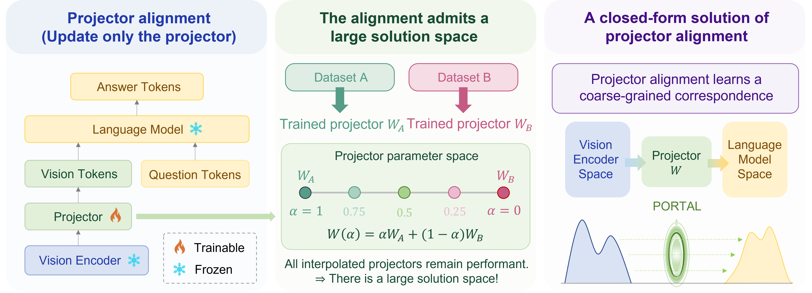

# Rethinking Projector Training in Multimodal LLMs

[](https://neurips.cc/Conferences/2026)
[](https://arxiv.org/abs/2610.18598)
[](https://brbiclab.epfl.ch/projects/portal/)
[](https://github.com/mlbio-epfl/PORTAL/actions/workflows/ci.yml)

**[Fabian Gröger*](https://fabiangroeger96.github.io/)** · **[Naël Ouerghemi*](https://people.epfl.ch/nael.ouerghemi)** · **[Shuo Wen*](https://wenshuo128.github.io/)** · **[Maria Brbić](https://brbiclab.epfl.ch/team/)**

---

## Overview



Multimodal LLMs are typically trained by first aligning a vision encoder with a language model via projector training on large image-caption datasets, followed by joint training of the full multimodal model. Despite its widespread use, the role of the projector training stage remains poorly understood.

We find that **(i)** using only 10–20% of the data for projector training already recovers most downstream performance gains, and **(ii)** projectors trained on different datasets can be linearly interpolated while largely preserving performance. These results suggest that projector training mainly performs a **coarse alignment**, which many different projectors achieve equally well.

Motivated by these findings, we propose **PORTAL** (**P**rojector via **O**ptimal-transpo**RT** **AL**ignment), a **training-free** projector initialization that requires **neither paired image-caption data nor gradient-based optimization** — only per-modality summary statistics. PORTAL computes an optimal-transport map between Gaussian approximations of the vision and language feature distributions on a shared principal subspace, so the projector training stage can be skipped entirely. Without any paired data, PORTAL matches the standard pipeline trained on 558k image-caption pairs across six LLM backbones, two vision encoders, and 16 benchmarks.

With source (vision) statistics $(\mu_s, V_s, \sigma_s)$ and target (language) statistics $(\mu_t, V_t, \sigma_t)$ from the top-$k$ PCA subspace of each modality, the projector's first layer is

$$W_1 = V_t \, \mathrm{diag}(\sigma_t / \sigma_s) \, V_s^\top, \qquad b_1 = \mu_t - W_1 \mu_s,$$

and the second layer of the standard LLaVA 2-layer MLP is fixed to the identity ($W_2 = I$, $b_2 = 0$). $W_1$ whitens the vision features, rotates them into the LLM's principal axes, and rescales each axis to the LLM's spread; $b_1$ recenters onto the LLM mean. See [`portal/construct.py`](portal/construct.py).

## Key Contributions

- **PORTAL**: A closed-form, training-free projector initialization built from per-modality feature statistics — no paired captions, no gradient steps.
- **Matches trained alignment**: Across 7 (vision encoder, LLM) settings and 16 benchmarks, PORTAL stays within 1.6 average points of the 558k-trained projector and exceeds it on 3 of 7.
- **Alignment budget reduction**: As a warm start, PORTAL reaches the full 558k-trained baseline with ~4k captions (~135x fewer alignment FLOPs) and surpasses it with as few as 10k.
- **Robustness**: Gains persist across projector architecture (linear vs. MLP), image pool, PCA rank, and target layer (PORTAL-ctx).

## Installation

### Requirements

- Python 3.10+
- PyTorch 2.0+
- CUDA (recommended for feature extraction, not required)

### Setup

1. Clone the repository:
```bash
git clone https://github.com/mlbio-epfl/PORTAL.git
cd PORTAL
```

2. Install dependencies:
```bash
pip install -e .            # installs torch, transformers, etc. from pyproject
# or: pip install -r requirements.txt
```

## Quick Start

### 1. Prepare an image pool

PORTAL estimates vision statistics from an *unlabeled* pool of natural images — no captions, no pairing. The paper uses COCO `val2017` with 1024 images:
```bash
mkdir -p data/coco && cd data/coco
wget http://images.cocodataset.org/zips/val2017.zip && unzip val2017.zip
```

### 2. Build the projector

```bash
python scripts/build_projector.py \
    --image-dir data/coco/val2017 \
    --llm-model llava-hf/llava-1.5-7b-hf \
    --clip-model openai/clip-vit-large-patch14-336 \
    --k 512 \
    --out checkpoints/portal_vicuna_clip
```

This writes `checkpoints/portal_vicuna_clip/mm_projector_f.bin`, a drop-in replacement for a trained LLaVA projector checkpoint. From Python:
```python
from portal import construct_portal, save_projector

sd = construct_portal(image_dir="data/coco/val2017", llm_model="llava-hf/llava-1.5-7b-hf", k=512)
save_projector(sd, "checkpoints/portal_vicuna_clip")
```

### 3. Stage-II instruction tuning and evaluation

Use the PORTAL checkpoint as the projector initialization and run the **standard, unchanged** LLaVA-665k instruction tuning, then evaluate with [`lmms-eval`](https://github.com/EvolvingLMMs-Lab/lmms-eval) on the 16-benchmark suite. PORTAL only produces the projector initialization; the training/eval stack is the usual LLaVA one. See [`examples/quickstart.md`](examples/quickstart.md) for the full walkthrough.

> **Scope.** This repository provides the PORTAL construction and the Random baseline. The LLaVA Stage-II training corpus/code and the `lmms-eval` benchmark suite are external and unchanged.

## Configuration

Construction is driven by command-line flags (see `python scripts/build_projector.py --help`). You can also load options from a YAML file with `--config configs/portal.yaml` (flags override the file). Key options:

| Flag | Default | Meaning |
| --- | --- | --- |
| `--llm-model` / `--clip-model` | Vicuna-1.5-7B / CLIP-L-336 | Target LLM and vision encoder (any CausalLM/LLaVA + CLIP). |
| `--k` | `512` | PCA rank; robust over {64,128,256,512,1024}. |
| `--n-images` | `1024` | Images sampled from the pool for vision statistics. |
| `--max-scale-ratio` | `100.0` | Clamp on per-axis scale $\sigma_t/\sigma_s$ (value $\le 0$, or `null` in a config, disables it). |
| `--layer` | `0` | Target block for PORTAL-ctx (0 = input embeddings = default PORTAL). |
| `--method` | `portal` | `portal` or `random` (Table 1 baseline). |

## Reproducing the paper

| Paper result | What to run |
| --- | --- |
| **Table 1** (PORTAL vs. Trained vs. Random, 7 (encoder, LLM) pairs) | `build_projector.py` once per pair (vary `--llm-model` / `--clip-model`), then standard LLaVA Stage-II + lmms-eval. `--method random` for the Random baseline. |
| **Rank ablation** (k in {64, 128, 256, 512, 1024}) | `build_projector.py ... --k <k>` for each `k`. |
| **Linear vs. MLP projector** | Same projector; swap the LLaVA projector to a single linear layer in your training config ($W_2$ is already identity). |
| **Image-pool ablation** | Point `--image-dir` at a different pool; vary `--n-images`. |
| **Target-layer ablation / PORTAL-ctx** (L = 0, 4, 8) | `build_projector.py ... --layer <L> --prompts examples/words.txt`. |

## Repository Structure

```
portal/
├── stats.py        # pca_stats — mean, top-k PCA basis, per-axis spread
├── features.py     # CLIP per-patch vision features over an image pool (source)
├── targets.py      # LLM embedding table (L=0) and hidden states (L>0) (target)
├── construct.py    # build_portal — the closed-form map, Eq. (2)
├── pipeline.py     # end-to-end: features -> stats -> projector
├── baselines.py    # Random (Kaiming) baseline
└── io.py           # save/load LLaVA-format projector checkpoints
scripts/
└── build_projector.py   # command-line entry point
configs/portal.yaml      # annotated configuration template
examples/                # quickstart walkthrough + prompts file
tests/test_portal.py     # unit tests (no model downloads)
```

## Tests

```bash
pip install -e ".[dev]"
pytest
```

The tests run on synthetic statistics and download no models: they check the state-dict layout, that $W_2$ stays the identity, the scale clamp, and that the mapped source matches the target's mean and covariance on the top-$k$ subspace.

## Citation

If you find this work useful, please cite our paper:

```bibtex
@inproceedings{groger2026rethinking,
  title     = {Rethinking Projector Training in Multimodal LLMs},
  author    = {Gr{\"o}ger, Fabian and Ouerghemi, Na{\"e}l and Wen, Shuo and Brbi{\'c}, Maria},
  booktitle = {Advances in Neural Information Processing Systems (NeurIPS)},
  year      = {2026}
}
```

## License

MIT License - see [LICENSE](LICENSE) for details.
